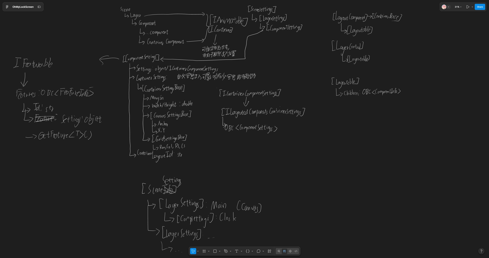
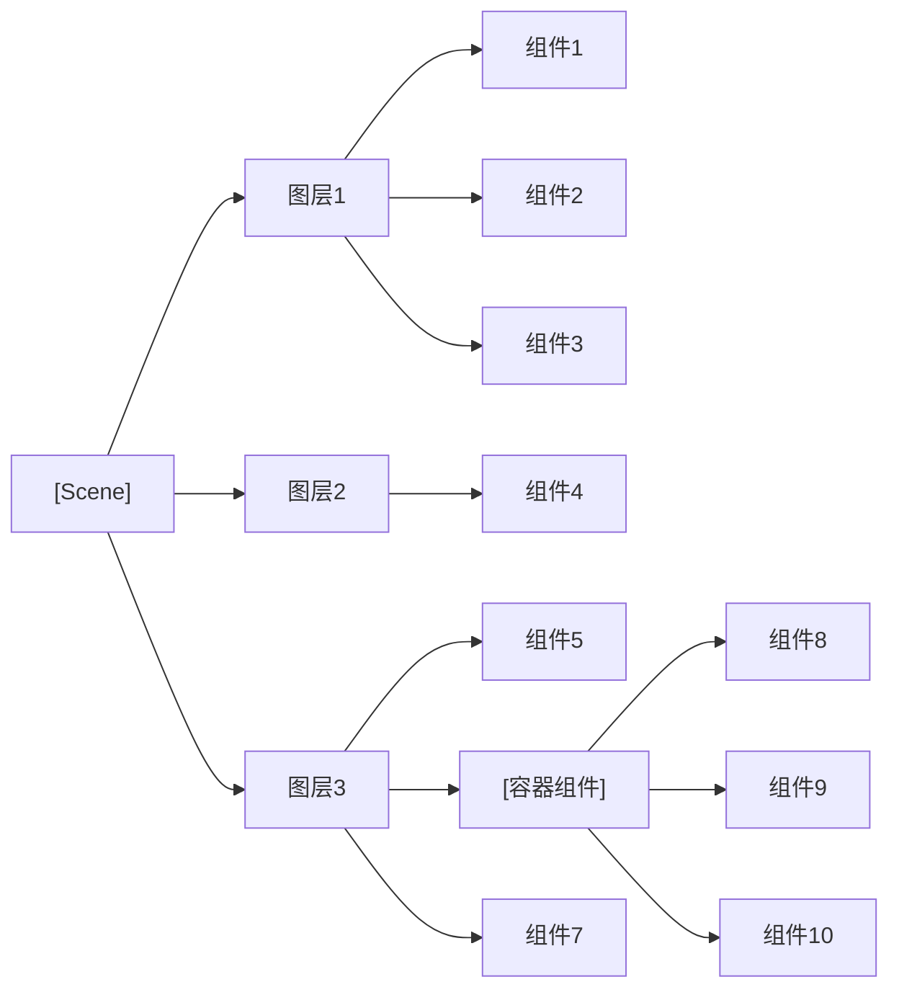
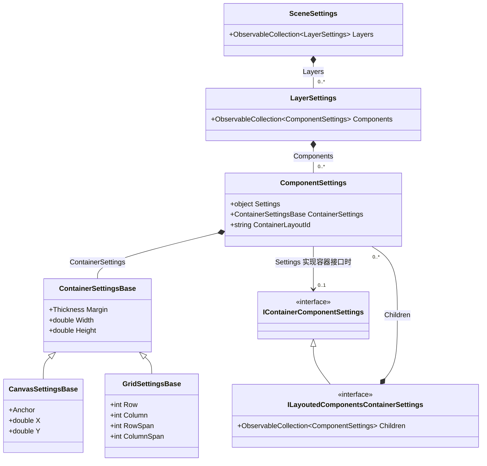
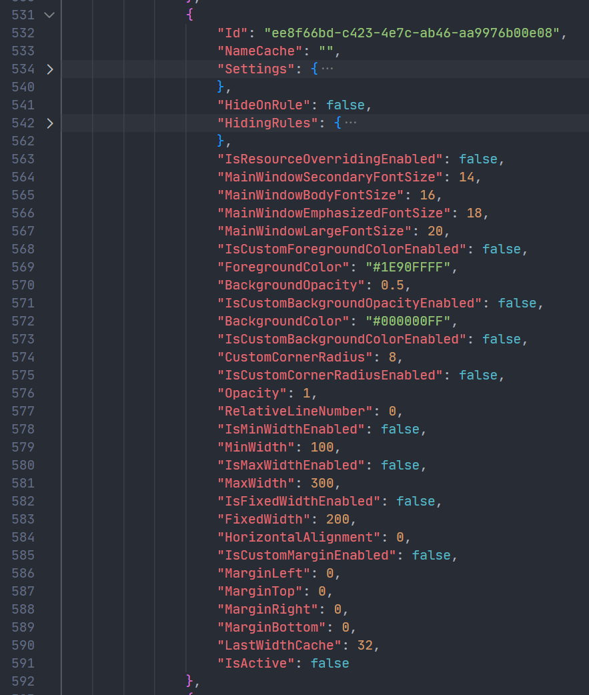
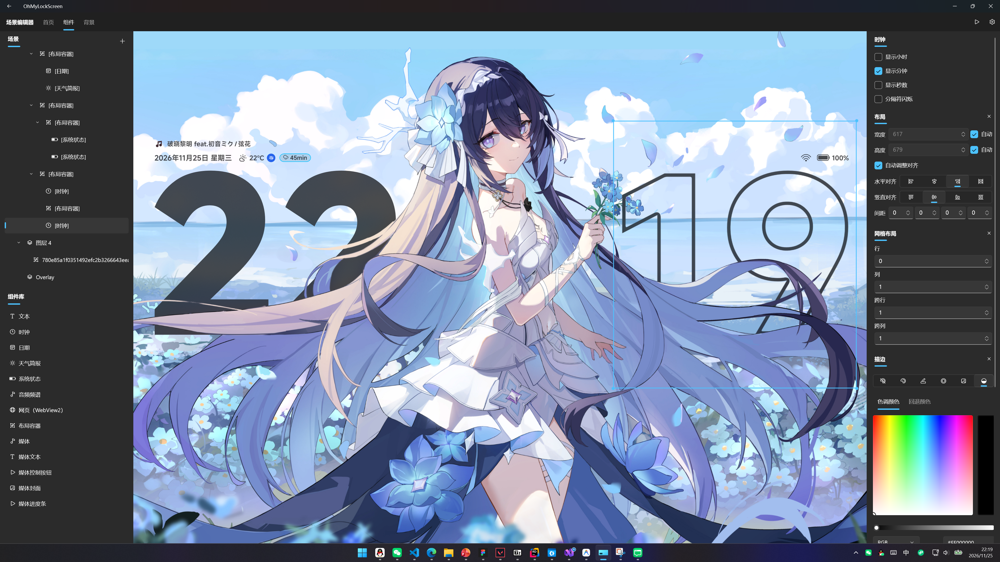
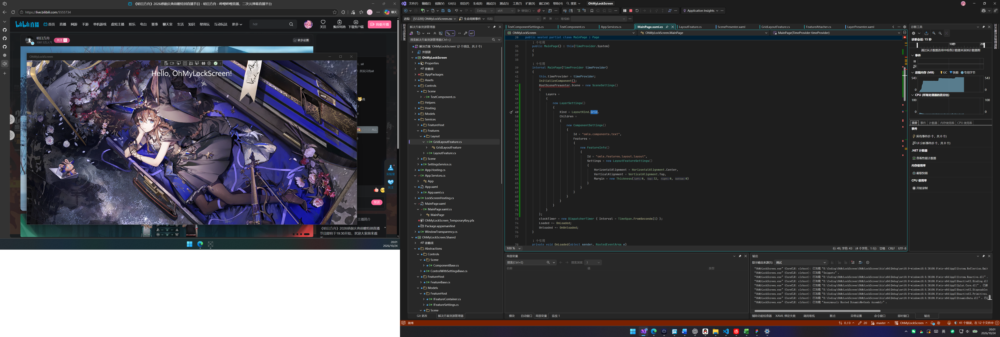

# 浅谈 OhMyLockScreen 场景「特性」

[OhMyLockScreen](https://github.com/HelloWRC/OhMyLockScreen/)（下文简称 OMLS）已经开发了一段时间了，其功能正日益成熟。OMLS 中的场景系统可以允许用户完全自定义锁屏上显示的元素，类似于 [ClassIsland](https://github.com/ClassIsland/ClassIssland) 的组件功能。这篇文章将介绍 OMLS 的场景系统中一个重要组成成员——「特性」功能：为什么我要引入这个功能，它现在发挥了什么作用，以及它未来可能会有什么用。

## 一切的开始



在设计 OMLS 的时候，我就希望能够引入一个类似 ClassIsland 的组件系统的自定义能力，并提供类似 Figma 的编辑体验，于是我在 ClassIsland 的组件系统的基础上开始设计。最初设想的场景系统中，和 ClassIsland 组件系统的区别无非就是 OMLS 的场景内的组件可以排布在任意位置，其余都可以直接借鉴 ClassIsland 组件系统的思路。

如同 ClassIsland，各级组件以以下的形式组织：



**但很快就迎来了第一个问题：如何便捷地控制一个组件在其父级容器组件中的行为。** 这个问题在 ClassIsland 也有一个与之对应的仍然还开放着的 Issue，但因为 ClassIsland 对容器组件内部针对于容器组件本身的设置没有太多需求，所以 ClassIsland 中并没有更深入地考虑这一点。而 OMLS 中的布局容器组件通常承担了像 `StackPanel`、`Grid` 这类容器的布局功能，而像 `Grid` 这类布局容器的通常需要内部的子组件通过某种方式声明自己在网格中的位置，所以引入一种针对于组件，可以让组件被外部组件/图层修饰的方案变得非常必要。

这时我的想法仍然是在 ClassIsland 现有的基础上进行修正。即在组件层引入一个额外的布局属性，来让组件的父组件知道应该怎么布局这个组件。



但这时候我很快就发现了个问题，就是这样的设计显然不算优雅。如果这个组件正在跨容器组件移动，或者是干脆上级修改了容器类型，导致这里面的设置失效，还得逐一对其中的设置进行修改。而且这个补丁显然没有完全解决上面提到的在子组件声明相对于容器组件的自定义设置的问题。我的直觉还是告诉我应该舍弃这个设计，转而寻找一个更简洁的设计，能够支持起现在，甚至未来的自定义能力的扩展。

**另外一个问题是，在组件设置中承载过多的自定义设置会让组件模型类变得非常臃肿。** 这既不利于维护，也在序列化时吃亏（因为会写入一堆完全没使用过的设置，导致场景配置文件大小迅速膨胀）。如果你对这没有概念，可以看一下 ClassIsland 现在的组件设置的成员有多大：



而 OMLS 每个组件通用可定制的配置比 ClassIsland 还要更多，比如要实现各种各样的布局设置、背景画刷、前景画刷、字体、文本、边框等等等等。如果全部塞到一个配置类里面，就会非常臃肿。同样臃肿的不止有配置模型，还有实现代码。如果在一个类里同时实现这些能力，那么这个类的实现很显然就会变得非常臃肿，引入许多不常激活，却在那里吃白饭的修饰元素。

同时和 ClassIsland 类似，图层和场景也有大部分和组件中类似的外观设计，必然要复用其中一部分实现。ClassIsland 的做法是封装一个单独的助手类，并将其通用的成员提取成一个接口。助手类只需接收实现这个接口的对象，以及一个要应用这些外观属性的控件，就能为其应用外观属性。然而，在 OMLS 中要应用的外观特性比 ClassIsland 多得多，并且也不是简单地设置某个属性或资源就能完成的。所以，引入一种更通用和简洁的特性附加实现就变的很有必要了。

## 从「物品组件」到「特性」

在思考这个问题的时候，我不由得想到了 Minecraft 的物品组件系统。

Minecraft 1.20.5 引入了物品组件系统，允许通过多个组件声明物品的特性。一个物品的某种组件，通常对应了其某种特性和功能，比如钻石剑默认持有的 `minecraft:damage` 组件，就对应其耐久度特性。如果我们甚至还可以利用此机制，制造出可以攻击的木棍（1.21.5+），例如使用以下命令：

``` mcfunction
/give @s minecraft:stick[minecraft:blocks_attacks={}]
```

这个指令给木棍添加了 `minecraft:blocks_attacks` 组件，使其具有了格挡攻击的能力。**这种为物品添加某种物品组件，达到修饰其功能的效果给了我很大启发。基于这个思路，我开始构想 OMLS 的「特性」系统。**

在我的想法中，组件除了组件本身的功能（甚至本身的功能理论上也可以，详见后文），都可以由「特性」进行驱动和修饰，比如设置布局属性、背景前景画刷、设置边框、添加变换等等。只需要组合多个特性，就可以实现很丰富的效果。



而其核心实现非常简单。类似于 XAML Behavior 系统，实例化后注入其设置和目标控件到特性实例中，在其成功挂载后会触发特性初始化事件，此时特性实现可以按需将需要修改的功能附加到目标控件上。比如要设置背景画刷，那就把背景画刷对象绑定到目标背景的背景属性上。而在特性卸载时，则触发其卸载流程，清理掉其先前的更改。

但这还有些问题。如果两个特性同时写入/绑定了相同的属性，那么可能会触发竞争，这时可能就会发生奇奇怪怪的问题。所以一种理论上更好的方式是不允许特性实现直接操作目标控件，转而提供一个附加接口，允许多个特性对相同的属性进行相同的修改操作，最终由特性引擎合并，保留优先级最高的特性的更改。但这个功能实现的成本很高，要考虑到各种各样的地方，比如特性可能需要以一些很刁钻的角度修改目标控件等等，而目前还暂时没有实现这个功能的必要，所以在 OMLS 中就暂时没有实现这种合并机制。

而进一步地，特性附加的目标不仅可以是组件，也可以是图层，甚至是场景。只要目标受支持，都可以对其进行修饰，而特性本身无需关心它到底是什么。**在理想的状态下** ，各个特性之间甚至也应该相互独立，无需关系对方的实现如何，也无需关心目标的实现如何。只要目标支持，就可以把特性挂载上去。

并且特性和组件一样，都允许在应用内和插件自由注册。所以不仅应用内可以内置一些常用特性，插件也可以扩展特性能力。

在当时起草设计稿想到这一步时，我感觉豁然开朗。于是特性系统逐渐成型，**场景、图层和组件只需实现其基本的承载功能，剩余的修饰工作交给特性。只要多个特性组合，就可以实现其需要的功能。**

## 开始实现

大概想好之后，我迅速开始打基础。在打好特性系统的地基后，我就开始让 AI 实现具体的特性实现。前面的几个特性实现起来都很顺利，并且效果都还不错，确实能像拼积木一样实现复杂的自定义功能，我也因此没有特别关心 AI 的实现如何。



确认这套系统可行后，我就把编辑器的设计稿发给 AI 实现。经过许多曲折，终于实现了基本的编辑和展示功能。在基础功能完成后，我开始利用特性系统进一步扩展自定义能力，而这套架构的不足便渐渐显现了出来。

前面提到过，理想情况下特性应该不关心目标控件的实现情况。然而在实际开发过程中，我注意到有些特性在修饰目标控件时，不得不依赖这样的对目标控件的 XAML 外层包裹：

``` xml highlights="2"
<MyDecorator1 x:Name="Decorator1">
    <MyDecorator2 x:Name="Decorator2"> <!-- 必须要在这里把原来的内容嵌套进去，才能实现期望的更改。 -->
        <ContentPresenter
            Content="{Binding Content, ElementName=RootPresenter, Mode=OneWay}"
            Foreground="{Binding ContentForeground, ElementName=RootPresenter, Mode=OneWay}"
            HorizontalContentAlignment="Stretch"
            VerticalContentAlignment="Stretch" />
    </MyDecorator2>
</MyDecorator1>
```

而现有的特性系统还不支持简单地把原来的内容解挂，然后把新的装饰对象包裹进去，于是 AI 只能直接对组件呈现器进行修改，在其中加入相应特性需要的接口。这样的侵入性操作很显然违背了特性系统的初衷，没有完全达到简化组件呈现器的实现的初衷，也不利于外部插件进行扩展。所以我又引入了一种 XAML 装饰接口，只需在目标控件包裹一次，特性等其它外部部件就可以将自定义的装饰对象通过此接口包裹到目标控件上，无需修改原始控件的 xaml 代码。

于是要实现上述的装饰流程，只需要：

```cs
target.Decorators.Register(new MyDecorator1();, DecoratorPriorities.Stroke);
target.Decorators.Register(new MyDecorator2();, DecoratorPriorities.Stroke);
```

这极大简化了特性修饰目标控件的流程，同时也增强了应用的可扩展性。

## 结语

目前 OMLS 还在积极开发中，你也可以在 [GitHub 仓库](https://github.com/HelloWRC/OhMyLockScreen/)上关注开发进展，或者从[微软商店](https://apps.microsoft.com/detail/9pnh2x9k2v25)亲自下载体验。如果你有好的建议，或者发现了问题，也可以在 [Issues](https://github.com/HelloWRC/OhMyLockScreen/issues) 中汇报。目前这套机制还在演进中，我也期待它能在 OMLS 中创造更多的可能，并进一步演化和完善。如果 OMLS 加入了插件，也期待能看到有插件能通过这套机制实现一些有趣的效果。

写这篇文章的时候我也有个大胆的想法：如果组件本身的行为也直接由特性组合呢，特性直接通过写入控件模板来提供界面呢？理论上是可行的，但思路有些不太显然，不算是好的实现，所以就暂时先停留在想法上吧。
