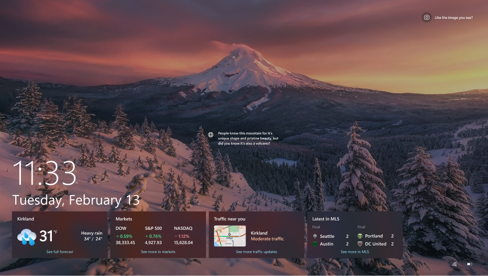
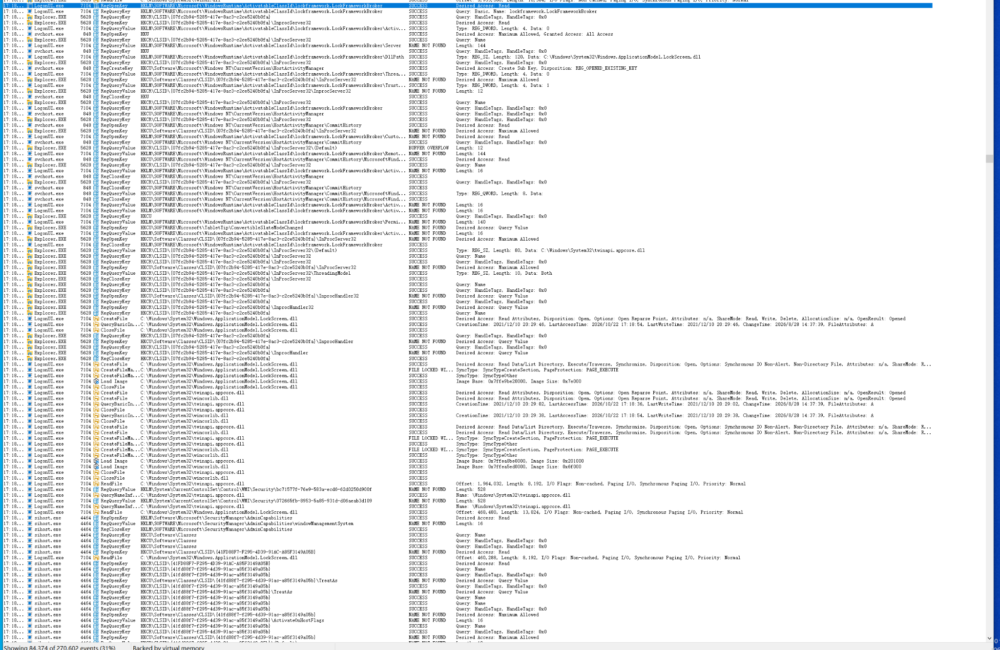
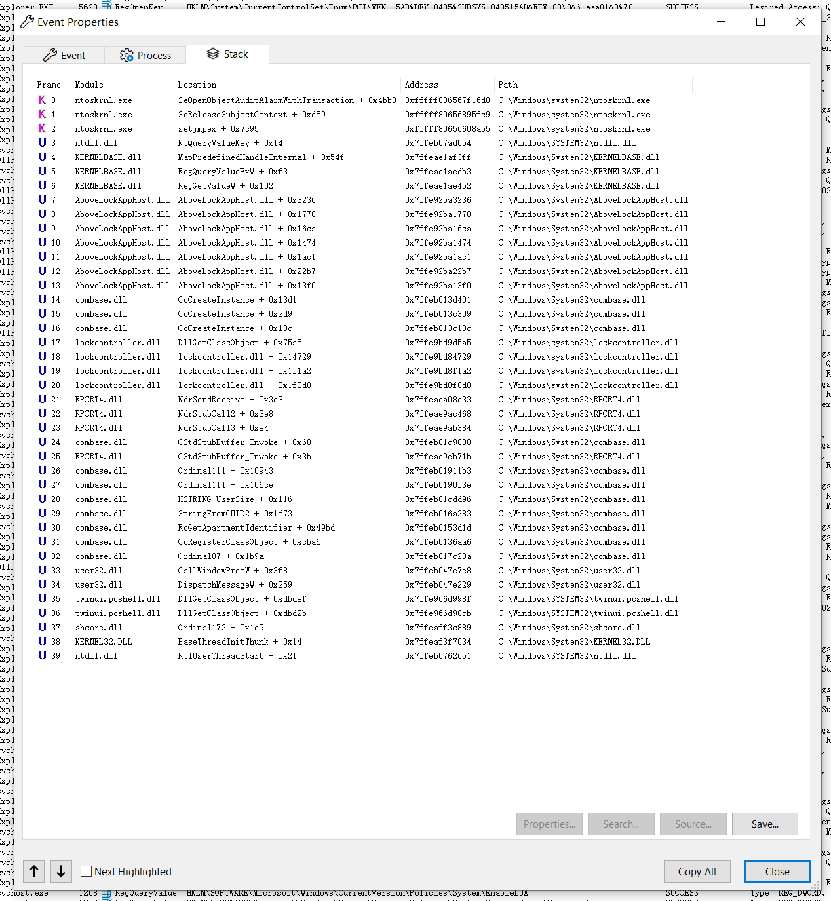
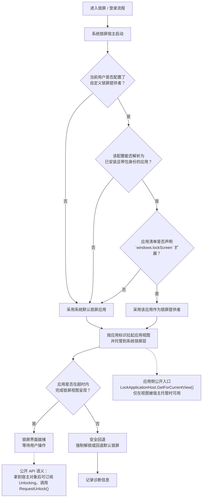

# 自定义 Windows 的锁屏实现



在 Windows 10 以来，系统的锁屏就是像这样显示一个静态壁纸（或者是随机轮播壁纸）、时钟、天气和广告的地方。与已经被玩出花的桌面自定义相比，目前鲜有人对锁屏界面进行深度的自定义，甚至我们将默认锁屏的壁纸替换为动态壁纸都有些困难。

但是如果我告诉你，自 Windows 10 开始，系统中其实存在这样一个鲜为人知的接口——没有官方文档，但却有一套完整的工作和兜底机制——来让用户将系统默认锁屏实现替换成其它锁屏实现呢？

接下来我们将介绍这一接口，以及我们应该如何实现一个自己的锁屏，在锁屏上显示自己喜欢的东西。

::: note
本文内容基于我电脑上的 Windows 版本 `26200.9711` 的测试结果介绍，在其它 Windows 版本上的表现可能会有所不同。
:::

## 关于这个接口

::: caution
以下介绍的内容为 Windows 中一个无文档的特性，不是公开承诺兼容的第三方接口。尽管其已经存在了相当长的时间，但无法保证其在将来也会按此方式工作。请不要过度依赖此功能，或将此功能用于生产环境。此外，不当的锁屏实现可能导致锁屏界面卡死、无法正常进入登录界面，或在锁定状态下泄露敏感信息。本文介绍的方法不修改 Windows 原生身份验证机制，也不能替代系统的访问控制。
:::

在 Windows 中，我们在进入登录画面前看到的默认的锁屏实际上是一个叫“Windows 默认锁屏”的 UWP 应用。同时它具有一定的特权，以在锁屏上获取和显示快速提示、通知等信息。而这个接口的作用，就是指定在登录画面前承担锁屏职责的应用。它可以是一个正常的锁屏，也可以是你想要的任何东西。只要符合相应的规范，就可以被选中作为锁屏显示。

这个锁屏应用就由注册表中的 `HKEY_CURRENT_USER\Software\Microsoft\Windows\CurrentVersion\Lock Screen\LockAppAumId` 键决定。在已测试的版本中，只要把这个值改成符合以下要求的 UWP 应用，那么系统就会将这个应用选作锁屏实现：

- 声明了 `windows.lockScreen` 扩展

是的，就这么简单，没有别的要求。只要你在你的 UWP 应用里声明了这个扩展，然后把 `LockAppAumId` 键改成你的应用的 AUMId，再按下 <kbd>Win</kbd> + <kbd>L</kbd>，就能看到你的应用以锁屏的形式出现在屏幕上了。

如果指定的应用没有被找到，或者是不符合上述要求，就会回退到默认锁屏 `Microsoft.LockApp_cw5n1h2txyewy!WindowsDefaultLockScreen`。如果锁屏应用意外退出，那么会立即进入登录页面。

需要注意的是，这个方法能且仅能替换锁屏实现，不能修改登录页面。

## 使用此接口

::: note
如果你被困在锁屏中无法退出了，按下 <kbd>Ctrl</kbd> + <kbd>Alt</kbd> + <kbd>Del</kbd> 可以直接返回登录页面。
:::

::: warning
建议在虚拟机或非主力设备上部署锁屏应用，并做好设置备份，不建议在主力设备上直接尝试。
:::

1. 创建一个 UWP 应用，然后在其起始页随便放些什么
2. 在其清单文件 `Package.appxmanifest` 中添加以下内容，声明 `windows.lockScreen` 扩展：
    ``` xml highlights="6"
    <Applications>
        <Application>
            <!-- ... -->
            <Extensions>
                <!-- ... -->
                <uap:Extension Category="windows.lockScreen" />
            </Extensions>
        </Application>
    </Applications>
    ```
3. 将应用包部署到目标机器
4. 备份原来的注册表值 `HKEY_CURRENT_USER\Software\Microsoft\Windows\CurrentVersion\Lock Screen\LockAppAumId`，以便后续恢复
5. 设置注册表值 `HKEY_CURRENT_USER\Software\Microsoft\Windows\CurrentVersion\Lock Screen\LockAppAumId` 为你的锁屏实现 AumID
6. 锁定电脑
7. 大功告成！你应该能看到你的锁屏应用作为锁屏出现在屏幕上了！

但这时我们还缺少解锁流程，也就是说我们的锁屏实现还不能自己退出锁屏，进入登录页面。显然我们不能每次解锁都让用户捡肥皂[^1]，所以接下来我们将介绍如何接入解锁流程，实现如原版锁屏那样点一下屏幕或按下任意键进入登录页面。

实现方法很简单，在需要解锁时直接退出应用即可。此时就会回到登录解锁页面。但这实际上不属于锁屏的正常退出流程，会被记录到微软的遥测事件中。

实际上，比较正规的方式是调用[`LockApplicationHost`](https://learn.microsoft.com/zh-cn/uwp/api/windows.applicationmodel.lockscreen.lockapplicationhost?view=winrt-26100)下提供的解锁接口，但这属于 Windows 的保留能力，第三方 UWP 应用无法调用，在此不做讨论。

至此，我们就完成了一个锁屏应用的基本闭环。你可以在此基础上，在上面显示些你喜欢的东西，比如动态壁纸、时钟、课表等等。只要是普通 UWP 应用能实现的，在这里也基本能实现。

## 恢复

要恢复至默认锁屏，只需要将 `LockAppAumId` 恢复为修改前的值。

在 Powershell 中执行：

``` powershell
Set-ItemProperty `
    -Path 'HKCU:\Software\Microsoft\Windows\CurrentVersion\Lock Screen' `
    -Name 'LockAppAumId' `
    -Value 'Microsoft.LockApp_cw5n1h2txyewy!WindowsDefaultLockScreen'
```

如果系统原先指定的 AumId 有所不同，应该将值替换为原先的值。

## 研究记录

下面简要地记录了我研究这个接口的一些过程。

在很早的时候，我就注意到 Windows 存在了一个名为 `HKEY_CURRENT_USER\Software\Microsoft\Windows\CurrentVersion\Lock Screen\LockAppAumId` 的注册表值，里面默认存储了默认锁屏应用的 AumId。看起来，这个接口具有替换锁屏实现的潜力。

直到最近我有时间时，进行了一些简单的实验。我一开始尝试将这个 AumId 替换为计算器的 AumId，然后进入锁屏。预期上，锁屏界面应该直接变成计算器，但实际上显示的仍然是系统的锁屏。

难道这是一个废弃的接口？在 GPT 的指导下，我使用 Procmon 抓取了和这个注册表值相关的事件。在进入锁屏的过程中，出现了大量读取这个注册表值的活动，并且都和锁屏模块高度相关。显然这个注册表值从某种程度上被使用了，只是我们还不知道它的具体调用方式。





我简单地查阅了微软的相关文档。在[Windows.ApplicationModel.LockScreen 命名空间](https://learn.microsoft.com/zh-cn/uwp/api/windows.applicationmodel.lockscreen?view=winrt-26100)文档指出：

> 创建新的锁屏界面是第三方开发人员**不可用**的功能。

而我也解析了默认锁屏应用的清单文件。不容乐观的是，这个应用也调用了大量 Windows 保留功能。看起来实现一个自定义的锁屏，没有想象中那么容易。

``` xml title="C:\Windows\SystemApps\Microsoft.LockApp_cw5n1h2txyewy\AppxManifest.xml".
<!-- ... -->
<Capabilities>
  <Capability Name="internetClient" />
  <wincap:Capability Name="targetedContent" />
  <wincap:Capability Name="lockScreenCreatives" />
  <wincap:Capability Name="packageContents" />
  <wincap:Capability Name="cortanaSettings" /><!-- for LockAppBrokerBaseTrust to access cortana registry -->
  <wincap:Capability Name="shellExperience" /> <!-- for access to WaitableExplorerProcessHandle -->
  <!-- ... -->
</Capabilities>
<!-- ... -->
```

但我们还不知道系统实际上选取锁屏提供应用的机制，也不知道缺少这些保留功能会造成什么影响。基于以上信息，接下来在 DeepSeek 和 REA 的帮助下，我展开了对相关接口的研究。

在经过研究后，得到了一个好消息和一个坏消息：

- 好消息是，锁屏应用的选取实际上与是否具有访问保留功能的能力无关。普通应用只要在具有 `windows.lockScreen` 扩展，并通过 `LockAppAumId` 被指定为锁屏应用的情况下就可以被选为锁屏应用。
- 但坏消息是，第三方锁屏应用无法直接访问[`LockApplicationHost`](https://learn.microsoft.com/zh-cn/uwp/api/windows.applicationmodel.lockscreen.lockapplicationhost?view=winrt-26100)，这也导致我们几乎只能通过退出应用来实现结束锁屏。

以下流程是根据逆向分析与实验结果整理的简化模型，并非微软公布的官方实现。部分异常处理路径尚未完整验证。



总而言之，我们已经有了一个从零定制锁屏界面的机会。将这些东西结合起来后，我成功实现了一个可工作的自定义锁屏原型。

<video controls src="/assets/videos/lockscreen-demo.mp4" title="自定义锁屏演示" style="width: 100%;"></video>

## 后记

事实上我不是第一个发现此机制的人。早在这项功能推出之时，就已经有人注意到了相关机制：

- [Is the Windows.ApplicationModel.LockScreen namespace available for non-kiosk use?](https://stackoverflow.com/questions/34266290/is-the-windows-applicationmodel-lockscreen-namespace-available-for-non-kiosk-use)
- [Content loads and runs before user has logged in](https://bugzilla.mozilla.org/show_bug.cgi?id=1462123)

可惜后续研究甚少，微软的文档也含糊其辞，导致这个特性没有真正走入大众视线。在经过 GPT、DeepSeek 和 REA 的辅助下，我才将这些离散的线索串联起来，形成了这个文章。

期待这篇文章能够启发更多开发者，开发出有意思的锁屏自定义工具。

[^1]: 早期 Windows 按下<kbd>Ctrl</kbd> + <kbd>Alt</kbd> + <kbd>Del</kbd>的示意图标形如捡肥皂的动作。
